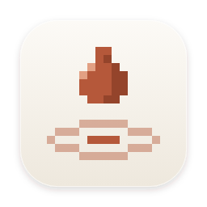

<p align="center"></p>

<h1 align="center">Super Agent</h1>

<p align="center"><b>用大白话说出你想要的软件，几家 AI 组成一个团队帮你做出来，做好就能直接打开用。</b></p>

Super Agent 是一款桌面软件，写给不懂编程的人。你不需要会写代码，也不需要懂开发流程：说一句「我想要一个记账的小网页」，剩下的规划、分工、编写、检查和交付都在软件里完成。

这个仓库只放安装包和更新说明。

---

## 它能帮你做什么

- **说一句话就开工**：用平常说话的方式提需求。软件会先把需求整理成一份大纲，像白板一样摆出每个模块、谁等谁，你看着顺眼点「批准」就开始。
- **几家 AI 组成你的团队**：Claude、ChatGPT（Codex）、Google Antigravity、Kimi、Grok、DeepSeek、GLM，你有哪家就用哪家。它们在像素小办公室里分工：有人写、有人检查、有人看界面，还会互相挑毛病。大纲也可以让几家同时给意见，好的建议一键采纳。
- **看得见进度**：一棵进度树，做完的是绿色，正在做的是黄色。需要你拍板时会提醒你，其余时间你不用盯着。
- **出错先自救**：某个模块反复不通过，会换一家 AI、换个思路接手；实在不行才用一句人话问你，旁边有「帮我解决」。
- **做完能直接用**：交付后点「打开」就能运行，项目文件夹里还会放一个「打开<项目名>」，下次双击就行。想改哪里，说一句话，只返工相关的那一块。
- **越用越懂你**：记住你喜欢的颜色、风格和常提的要求，下次自动带上；批准过的事情会少问你。
- **看得到额度和花费**：各家 AI 还剩多少额度、这次需求每家用了多少，都写在界面上。
- **手机也能管**：扫一下二维码，就能在手机上提需求、看进度、做决定，AI 在电脑上继续干活。

适合用来做：个人小工具、小网页、小游戏、给自己或团队用的小程序，或者把一个想法快速做成能点开看的样子。

## 下载与安装

到 [Releases 页面](https://github.com/kissmvp8-afk/super-agent-releases/releases) 下载最新版本。

| 系统 | 状态 | 下载 |
| --- | --- | --- |
| Windows 10 / 11（64 位） | 预览版 0.3.0 | [desktop-v0.3.0](https://github.com/kissmvp8-afk/super-agent-releases/releases/tag/desktop-v0.3.0) 里的 `SuperAgent-Setup-0.3.0.exe` |
| macOS | 还没发布，正在测试 | — |

### Windows 安装步骤

1. 下载 `SuperAgent-Setup-0.3.0.exe`。
2. 双击安装。**不需要管理员权限**，可以自己选安装位置，装好后桌面和开始菜单都有「Super Agent」。
3. 安装包还没有数字签名，Windows 可能提示「Windows 已保护你的电脑」或「未知发布者」。确认是从本页下载的，点「更多信息」→「仍要运行」即可。
4. 第一次打开会有 30 秒引导：连上一家 AI、选一个项目文件夹、说出第一个需求。

安装包自带 Python、Node.js 和 Git，**不用另外安装任何东西**，也不会改动你电脑上已有的版本。

**想确认安装包没被改过（可选）**：在下载文件夹打开 PowerShell，运行

```powershell
Get-FileHash .\SuperAgent-Setup-0.3.0.exe -Algorithm SHA256
```

把结果和同一个版本里的 `SuperAgent-Setup-0.3.0.exe.sha256` 对一下，一样就没问题。

### 你还需要

- 至少一家 AI 的账号（比如 Claude、ChatGPT 或 Google）。软件里的「AI 助手」可以一键安装各家的程序，按提示登录即可；DeepSeek 和 GLM 用 API Key，Key 只存在电脑自己的钥匙串里。
- 能上网（AI 在各家自己的服务上工作）。

---

## 更新记录

最新的写在最上面。每个版本都写清楚：新增了什么、改了什么、修了什么，以及要注意的地方。

### 0.3.0 · 2026-11-25 · Windows 预览版

第一个公开的预览版。

**新增**

- 用大白话提需求，自动整理成白板式大纲；可以修改、让几家 AI 同时提意见，每条建议一键采纳。
- 「你的团队」：七家 AI 画成像素办公室里的角色，各有分工；没连上的 AI 自动换人；常用的角色和你的习惯会自己长成团队规矩；新增点评席。
- 多个模块同时开工；模块之间可以互相捎话（比如「接口改了」），分工表里看得到谁对谁说了什么。
- 进度树和大进度条：做完绿色、正在做黄色、等你验收蓝色、需要你处理的红色。
- 出错先自救：连续检查不过会换一家 AI 换思路接手，再不行才用一句人话问你，并提供「帮我解决」。
- 交付更省心：做好的项目点「打开」直接运行；说一句话就能小改；看得到每家 AI 这次干了多少；项目记忆记住你的偏好。
- 首次使用 30 秒引导；需要你拍板时发系统通知；打开就自动认出电脑上已装的 AI。
- 显示各家 AI 的剩余额度；一键更新所有 AI 程序，带下载进度。
- 手机遥控：扫码连接，在手机上提需求、看进度、做决定；干活时电脑不睡；内置 Tailscale，在外面也能连。
- 整体界面换成「如水」风格：暖色纸面、柔和过渡，动效统一不闪烁。

**注意**

- 安装包未签名，首次运行需要在 Windows 提示里点「仍要运行」。
- 还没有自动更新，新版本请回到本页下载安装。

---

## 发布新版本时（维护说明）

每次发版都要在上面的「更新记录」里加一节，规则如下：

1. 加在「更新记录」最上面，标题格式：`### <版本号> · <日期> · <平台 / 预览版或正式版>`。
2. 按「新增 / 改进 / 修复 / 注意」分组（没有的组可以省略），每条一句话，写用户能感觉到的变化，不写代码细节。
3. 同步更新「下载与安装」表格里的版本号和链接。
4. Release 的标签用 `desktop-v<版本号>`，附上安装包和对应的 `.sha256` 文件；Release 说明可以直接复制这一节。

详细的写法和模板见 [CHANGELOG-GUIDE.md](CHANGELOG-GUIDE.md)。
